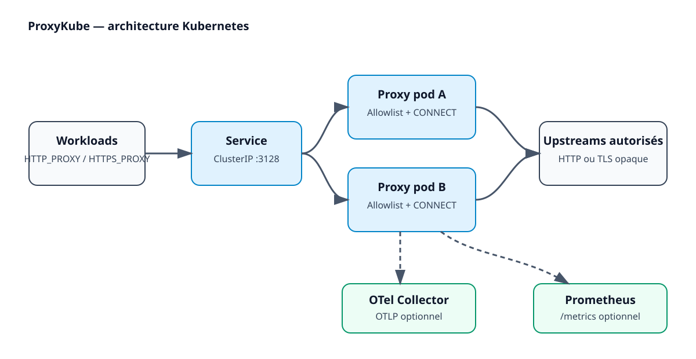
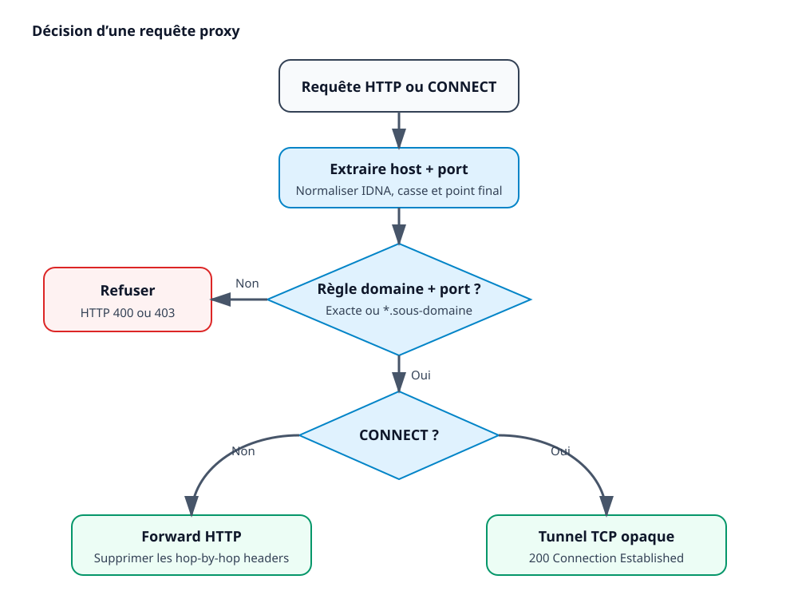

# Architecture

## Components

The client sends absolute-form HTTP requests or HTTPS `CONNECT` requests to the ClusterIP Service. The proxy normalizes the requested host, checks the host and port against its immutable allowlist, and only then opens an upstream connection.

The proxy never decrypts TLS. For HTTPS, it relays opaque bytes after returning `200 Connection Established`. Consequently, filtering is based on the hostname and port supplied in `CONNECT`, not on the HTTP contents inside TLS.

## Request decision flow

Rules are fail-closed. Exact rules match one host. A wildcard such as `*.example.org` matches one or more subdomain levels, but not `example.org`. Every rule requires at least one port. IP literals follow the same exact-match rule and cannot use wildcards.

## Observability

Instrumentation uses the OpenTelemetry API regardless of which exporter is enabled:

- OTLP exports traces and metrics to a Collector when `otel.enabled` is true.
- Prometheus registers `/metrics` when `prometheus.enabled` is true.
- Both exporters may run together or remain disabled.
- `slog` emits JSON by default and adds `trace_id` and `span_id` when available.

Prometheus labels intentionally exclude destination domains to prevent unbounded cardinality. Traces and structured logs may contain the normalized destination domain, but never URL paths, queries, bodies, credentials, or request headers.

## Kubernetes lifecycle

The ConfigMap is mounted read-only. Its checksum is part of the Deployment pod template, so a Helm configuration change triggers a rolling update. Readiness becomes true only after the proxy and administration listeners are bound. SIGTERM makes readiness fail, gracefully drains both HTTP servers, closes idle upstream connections, and flushes telemetry.
